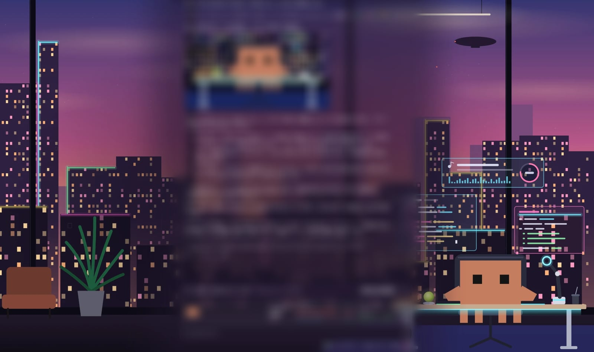
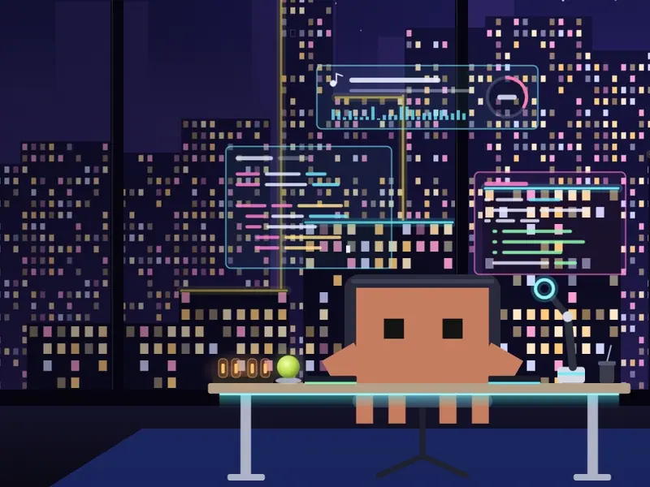
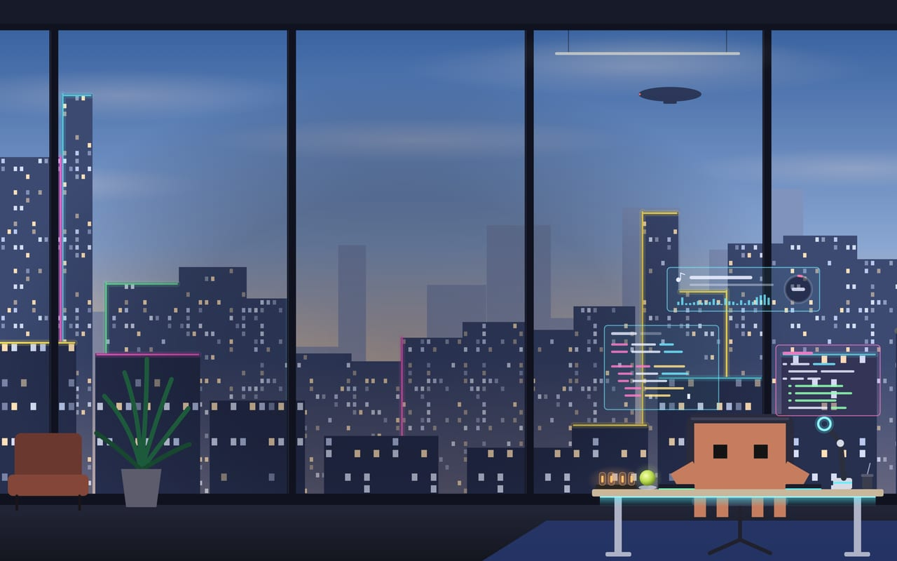
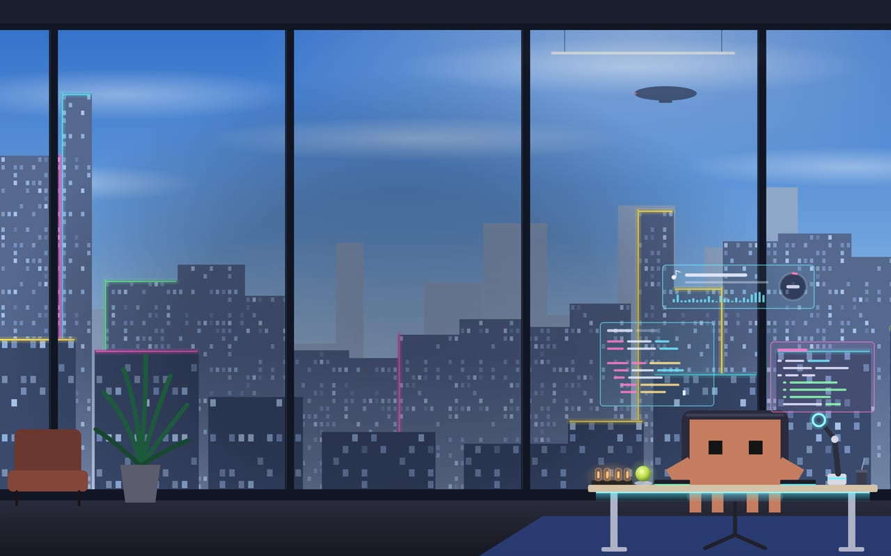
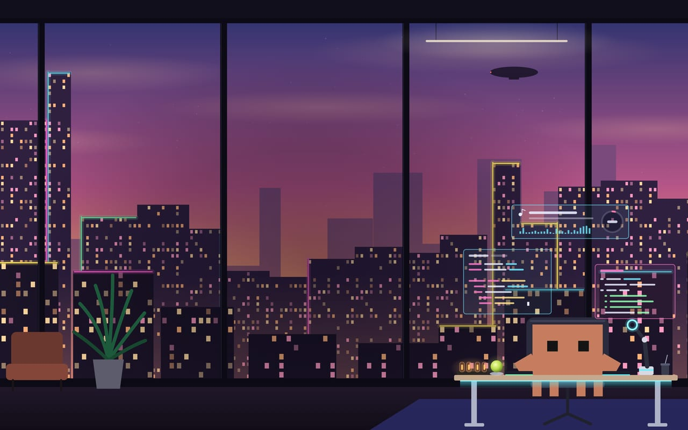
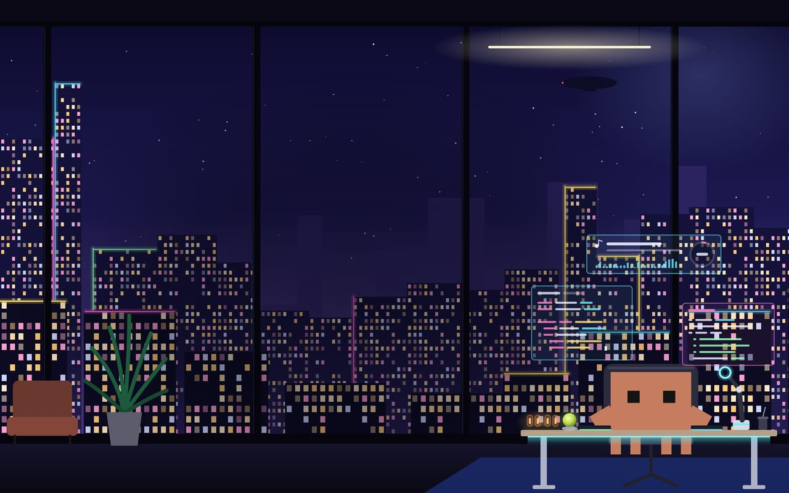
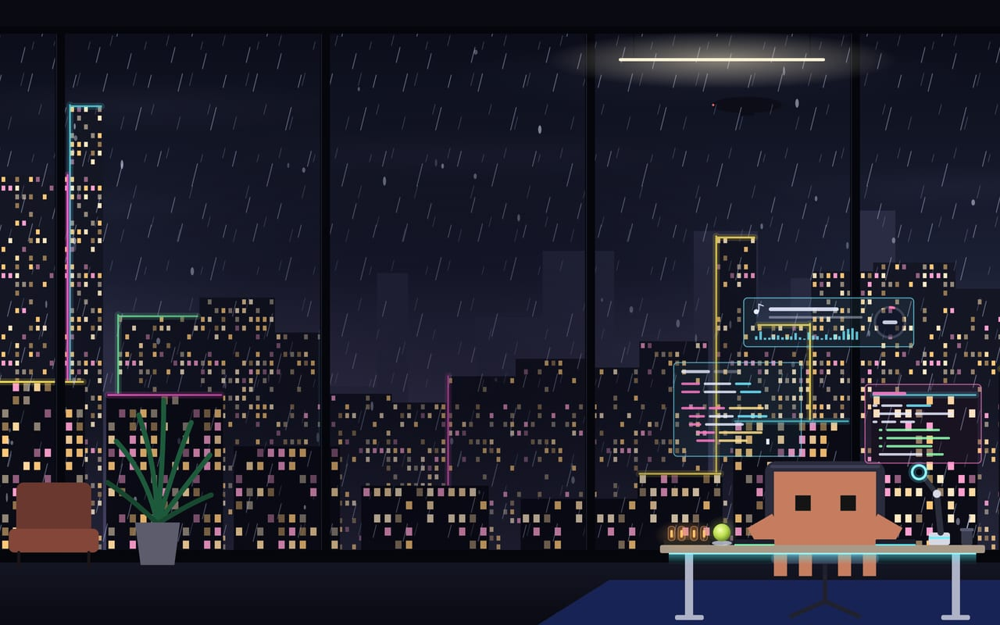
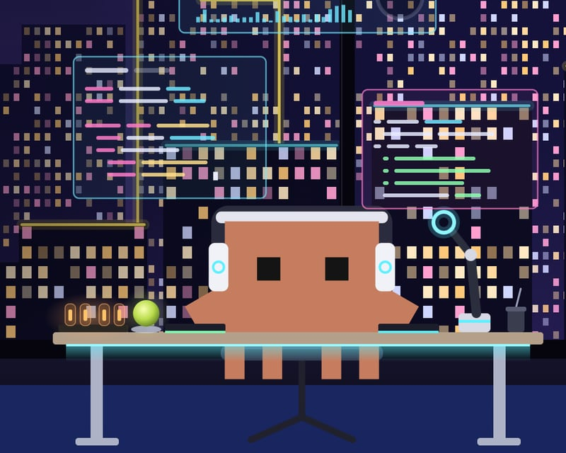
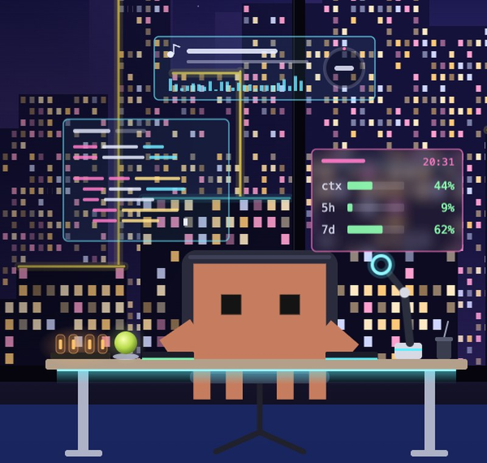

# clawd-workroom

Claude Code のデスクトップアプリの会話の背景を、高層階にある Clawd の作業部屋にする非公式ファンメイドの mod。

[](https://code.claude.com/docs/en/plugins/mods/overview)
[](https://www.anthropic.com/claude)
[](./LICENSE)

<p align="center">
  
</p>

**Claude Code × Claude Fable 5.2（HIGH）** で作りました（v0.2.0 の計器は Claude Opus 5.5（HIGH））。

会話の後ろに、62 階の作業部屋が広がります。床から天井までの窓の外にはネオンの街、右下の机では Clawd がキーボードを打っています。朝・昼・夕暮れ・夜は手元の時刻に合わせて移り変わり、雨の夜も選べます。アプリの配色（パネル・文字・線）も、時間帯ごとに部屋の色に合わせます。机の上の右のパネルには、時刻と、コンテキスト・5 時間枠・7 日枠の使用率が出ます。

部屋は、作者の別の作品 [FLOW DESK](https://github.com/tanuu5/clawd-flow-desk)（高層ビルの 62 階で、Clawd が作業用の曲を聴きながら仕事をするブラウザ 3D アプリ）の作業部屋を、1 枚の絵に描き直したものです。

> [!NOTE]
> 非公式のファンメイド作品です。Clawd は Anthropic の Claude Code のマスコットで、この作品は Anthropic とは関係ありません。

## スクリーンショット

<p align="center">
  
</p>

<table>
  <tr>
    <td width="50%"><br><sub>朝（5〜9 時）。</sub></td>
    <td width="50%"><br><sub>昼（9〜16 時）。雲がゆっくり流れます。</sub></td>
  </tr>
  <tr>
    <td><br><sub>夕暮れ（16〜19 時）。</sub></td>
    <td><br><sub>夜（19〜5 時）。窓の灯りが点いたり消えたりします。</sub></td>
  </tr>
  <tr>
    <td><br><sub>雨の夜。<code>/workroom 雨</code> で選びます。</sub></td>
    <td><br><sub>ヘッドホンあり。<code>/workroom ヘッドホン あり</code> でつけます。</sub></td>
  </tr>
</table>

### 計器（v0.2.0）

<p align="center">
  
</p>

右のパネルに、時刻（右上）と、コンテキスト（ctx）・5 時間枠（5h）・7 日枠（7d）の使用率を出します。80% を超えると赤くなります。パネルの後ろは、会話の列と同じすりガラスです（ぼかしと濃さは `/workroom ガラス` に合わせます）。

いちばん上の画像は実際のアプリの画面です（中央の会話の列はぼかしています。v0.1.0 のときのもの）。動く画像とほかの画像は、mod が描く SVG をそのままブラウザで表示したものです。アプリではこの上に、半透明のパネルと会話が重なります。

## 使い方

入れると、何もしなくても背景が出ます。出ないときは、メッセージを 1 通送るか `/workroom` と打ってみてください。場面などを変えるのも `/workroom` です。

| 打つもの | 起きること |
| --- | --- |
| `/workroom` | いまの場面と、このウィンドウが背景を描いているかを表示する |
| `/workroom オート` | 手元の時刻に合わせて、朝・昼・夕暮れ・夜を切り替える（既定） |
| `/workroom 朝`　`昼`　`夕暮れ`　`夜`　`雨` | その場面に固定する |
| `/workroom オフ` | 背景を消して、アプリの元の見た目に戻す |
| `/workroom ガラス 30` | 会話の後ろのパネルの濃さを 0〜100 で決める。小さいほど背景がよく見え、大きいほど字が読みやすい（既定 50） |
| `/workroom ヘッドホン あり`　`なし` | Clawd にヘッドホンをつける・外す（既定はなし） |
| `/workroom 計器 あり`　`なし` | 右のパネルに時刻と使用率を出す・出さない（既定はあり） |

- 言葉は英語でも通じます（`auto`、`morning`、`day`、`sunset`、`night`、`rain`、`off`、`glass 30`、`headphones on`、`meters off`）。
- 計器は 15 秒おきに確かめ、時刻の分か使用率が変わったときだけ背景を描き直します。描き直しても、Clawd や窓の動きは頭に戻らず続きから動きます。5 時間枠と 7 日枠は、Claude のサブスクリプションで使っていて、そのセッションで最初の応答が返ったあとに出ます（それまでは `--`）。
- 選んだ内容は、このマシンのすべてのセッションで共通です。ほかの開いているセッションには、次にメッセージを送ったときに反映されます。
- オートのときは 5 分おきに時刻を見て、時間帯が変わっていれば場面を替えます。
- 背景が出ている間は、アプリを暗い配色で描きます（作者の環境では、外観の設定がライトでも暗い配色になりました）。
- 動きは CSS アニメーションだけです。macOS の「視差効果を減らす」がオンのときは止まるようにしてあります。

## インストール

**動作環境**：Claude Code のデスクトップアプリ（Code タブ）のうち、mod の背景（テーマ）を描ける版。作者は、macOS 版のデスクトップアプリ 5.11492.5（中に入っている Claude Code は 2.1.325）で確かめました。その前の版（中の Claude Code が 2.1.321）は背景を描かず、背景を頼む API の形も違うため動きません。ターミナルの `claude` や VS Code 拡張では、背景は出ません。

ターミナルで動かしている Claude Code のセッションの入力欄に、次の 1 行を打ちます（マーケットプレイスを足すか聞かれたら `y`、続けて入れる範囲を選びます）。

```text
/plugin install clawd-workroom --marketplace tanuu5/clawd-workroom
```

シェルからなら、こちらです。

```bash
claude plugin install clawd-workroom --marketplace tanuu5/clawd-workroom
```

入れたあと、デスクトップアプリで新しいセッションを開くと背景が出ます。出ないときは `/workroom` と打つと、このウィンドウが背景を描いているかどうかが分かります。外すときは `/plugin` の画面で無効にします。

### この mod がすること・しないこと

mod は Claude Code の中で、あなたの権限のまま動きます。入れる前に中身を確かめてください。

- フックするイベント：`session.start`（コマンドの登録と背景の設定）、`prompt.submit`（ほかのセッションで選び直した内容を取り込むだけ。プロンプトの文面は読まず、変えません）、`command.run`（`/workroom` だけ）、`ui.render`（背景の `Backdrop` だけ）。
- 使う API：`$.theme.set()`・`$.theme.clear()`（背景と配色）、`$.store`（選んだ場面・ガラスの濃さ・ヘッドホンと計器の有無を覚える）、`$.clock`（時刻、5 分おきの場面の確認、15 秒おきの計器の確認）、`$.session.usage()`（コンテキストと利用枠の使用率を読む）、`$.ui.invalidate()`（計器が変わったときに背景を描き直す）、`$.command.register()`、`$.ui.toast()`（失敗したときの通知）。
- 実行するコマンド：`/bin/date +%z`（時間帯を決めるため、時差を一度だけ聞く）。
- ファイルは読みません。書き込むのは Claude Code が mod ごとに用意する保存領域（`$.store`）だけです。ネットワーク通信も、モデルへの問い合わせもしません。
- セッションのテーマは 1 つだけです。ほかのテーマの mod と一緒に使うと、あとから設定したほうが勝ちます。`/workroom オフ` は、この mod が背景を出していたときだけ、テーマを消します。

## 制作について

企画・ディレクション：**たぬ**　／　開発：**Claude Code（Claude Fable 5.2・推論レベル HIGH）**、v0.2.0 の計器は **Claude Code（Claude Opus 5.5・推論レベル HIGH）**

デスクトップアプリの mod でテーマを作れるようになった日に、「Clawd が高層階で作業している部屋を背景にしたい」という思いつきから作りました。背景は 1 枚の SVG で、街のビル・窓の灯り・ネオンは決まった種の乱数から毎回同じ形に組み立てています。窓はタイル状の模様で塗り、点いたり消えたりする窓だけを 1 つずつ重ねることで、13 万字までという SVG の上限の 3 割ほどに収めました。会話が乗る中央は街を低く・暗くして、見せ場の机は右下に寄せています。空の色と時間帯の区切りは、元になった FLOW DESK の設定に合わせました。Clawd は、以前の作品で描き起こした SVG の「PC 作業中」のポーズを、比率を変えずに置いています。

## 更新履歴

- **2026-11-14**（v0.2.0）：計器を追加。右のパネルに時刻とコンテキスト・5 時間枠・7 日枠の使用率を出し、パネルの後ろをすりガラスにした（`/workroom 計器 あり｜なし`）
- **2026-11-14**（v0.1.0）：公開

## 開発

```text
.claude-plugin/marketplace.json        マーケットプレイスの定義
plugins/clawd-workroom/
  .claude-plugin/plugin.json           mod の定義
  hooks/hooks.json                     読み込むモジュール
  hooks/register.tsx                   本体（場面の選び方、/workroom、背景を描くフック）
  hooks/scene.ts                       背景の SVG（街・部屋・机の Clawd、5 場面）
  hooks/palette.ts                     場面ごとの配色を返す
  hooks/palette-data.ts                配色のデータ（tools/make-palette.mjs が作る）
  tests/workroom.test.tsx              テスト
tools/
  palette-source.mjs                   配色の元（面と文字の色、役割の色）
  make-palette.mjs                     配色のデータを作り直す
```

手元の版を直接読み込むには、`claude --plugin-dir ./plugins/clawd-workroom` で起動します。起動フラグを渡せないデスクトップアプリでは、`~/.claude/settings.json` の `env` に `CLAUDE_CODE_PLUGIN_DIRS` として、このフォルダの絶対パスを書きます（反映にはセッションの開き直しが必要です）。

```bash
claude plugin validate ./plugins/clawd-workroom
```

```bash
claude plugin test ./plugins/clawd-workroom
```

`claude` は、デスクトップアプリと同じか新しい版のものを使ってください。古い版は背景の API を知らず、警告を出します。

配色を変えるときは `tools/palette-source.mjs` を直し、次のコマンドでデータを作り直します。`make-colors.js` は、Claude Code の plugin-authoring スキルのフォルダにあるファイルです（このリポジトリには入れていません）。

```bash
node tools/make-palette.mjs <make-colors.js のパス>
```

## クレジット・ライセンス

- コード：MIT License（[LICENSE](LICENSE)）© 2026 たぬ
- **Clawd について**：Clawd は Anthropic の Claude Code のマスコットです。この mod の Clawd は、公式アセットを使わずに SVG で描き起こした二次創作（ファンアート）です。Clawd のキャラクターは MIT License の対象外で、名称とキャラクターの権利は Anthropic に帰属します。
- 配色のデータ（`hooks/palette-data.ts`）は、Claude Code の plugin-authoring スキルに入っている `make-colors.js` で作りました。色の名前は Claude のデザインシステムのものです。
- MIT License の対象はこのリポジトリのコードと文章です。「Claude」の名前や商標の使用を許諾するものではありません。
